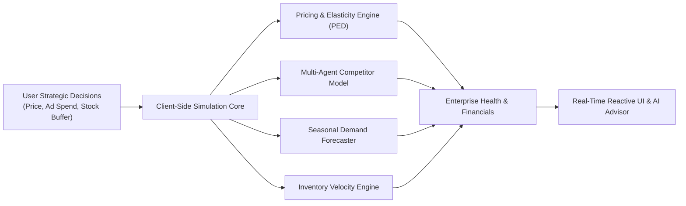
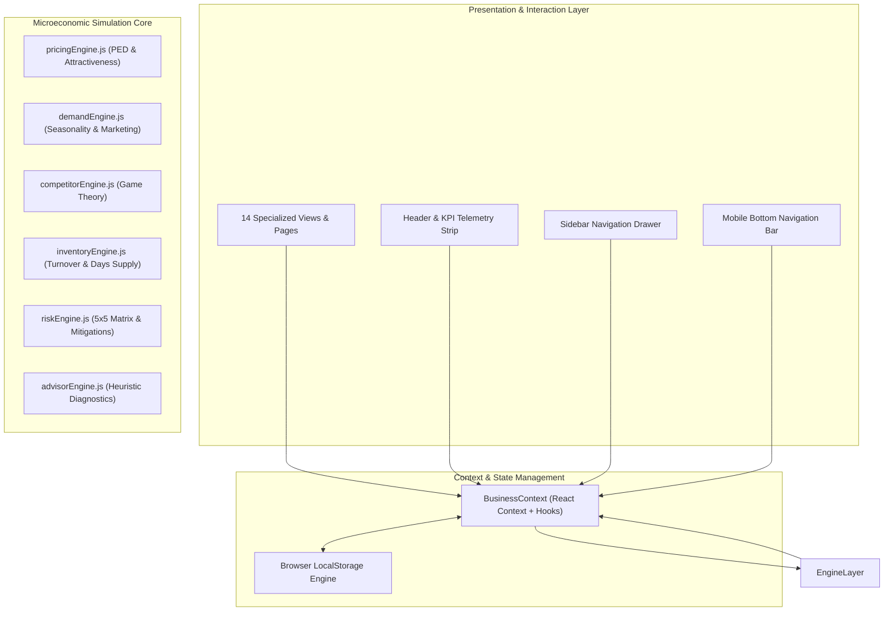
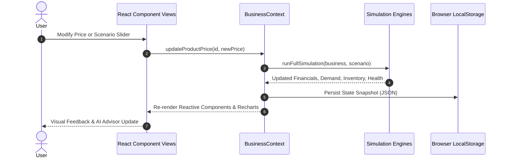

# 📊 TwinMarket AI: Autonomous Virtual Market Simulation Platform
## Comprehensive Technical Project Report & Architectural Dossier

---

## 📑 Table of Contents
1. [Executive Summary](#1-executive-summary)
2. [Project Vision & Core Objectives](#2-project-vision--core-objectives)
3. [System Architecture & Design Philosophy](#3-system-architecture--design-philosophy)
4. [Mathematical Models & Simulation Engines](#4-mathematical-models--simulation-engines)
5. [Core Functional Modules](#5-core-functional-modules)
   - [5.1 Executive Business Overview Dashboard](#51-executive-business-overview-dashboard)
   - [5.2 Enterprise Health Score & Algorithmic Gauge](#52-enterprise-health-score--algorithmic-gauge)
   - [5.3 Product Management & Unit Economics](#53-product-management--unit-economics)
   - [5.4 AI Price Elasticity & Margin Laboratory](#54-ai-price-elasticity--margin-laboratory)
   - [5.5 Competitor Intelligence & Multi-Agent Game Theory](#55-competitor-intelligence--multi-agent-game-theory)
   - [5.6 Behavioral Demand Forecasting & Seasonality](#56-behavioral-demand-forecasting--seasonality)
   - [5.7 Macroeconomic Market Shock Simulator](#57-macroeconomic-market-shock-simulator)
   - [5.8 Supply Chain & Warehouse Inventory Velocity](#58-supply-chain--warehouse-inventory-velocity)
   - [5.9 5×5 Enterprise Risk Coordinate Matrix](#59-55-enterprise-risk-coordinate-matrix)
   - [5.10 Heuristic Conversational AI Business Advisor](#510-heuristic-conversational-ai-business-advisor)
   - [5.11 Multi-Variable "What-If" Decision Sandbox](#511-multi-variable-what-if-decision-sandbox)
   - [5.12 Growth Strategy Trajectory Comparison](#512-growth-strategy-trajectory-comparison)
   - [5.13 Executive Audits, Reports & Data Export](#513-executive-audits-reports--data-export)
6. [Design System & Aesthetics: Holst "Барвинок" (Periwinkle)](#6-design-system--aesthetics-holst-барвинок-periwinkle)
7. [Mobile Viewport Architecture & Touch Ergonomics](#7-mobile-viewport-architecture--touch-ergonomics)
8. [Data Flow, State Management & Persistence](#8-data-flow-state-management--persistence)
9. [Technology Stack & Dependency Matrix](#9-technology-stack--dependency-matrix)
10. [Directory Structure & Module Layout](#10-directory-structure--module-layout)
11. [Build Performance & Production Metrics](#11-build-performance--production-metrics)
12. [Strategic Future Roadmap](#12-strategic-future-roadmap)

---

## 1. Executive Summary

**TwinMarket AI** is a client-side digital twin simulation and decision-intelligence platform built for modern retail and e-commerce enterprises. The application empowers business owners, product managers, and retail analysts to test pricing hypotheses, model competitor counter-reactions, simulate supply chain shocks, and forecast cash runways—all in real-time within the web browser without any server dependencies or data egress risks.

Unlike conventional analytics dashboards that simply present historical backward-looking metrics, TwinMarket AI acts as a **predictive digital laboratory**. Every strategic change—such as modifying a product price, increasing ad expenditure, or adjusting safety inventory buffers—triggers an instant microeconomic recalculation across customer demand elasticity, rival store market share, inventory turnover, and cash flow projections.



---

## 2. Project Vision & Core Objectives

### The Business Challenge
In contemporary commerce, retail pricing decisions and marketing budget allocations are frequently executed based on intuition or unverified assumptions. When a business alters prices or scales ad spend:
- **Competitors respond dynamically** through counter-promotions or price undercutting.
- **Consumer demand fluctuates non-linearly** based on category-specific price sensitivity.
- **Stockouts and overstock carry severe penalty costs**, causing immediate lost gross revenue or tying up critical working capital.

### The TwinMarket Solution
TwinMarket provides an autonomous virtual market sandbox that enables businesses to:
1. **Stress-Test Before Committing**: Simulate pricing adjustments against rival catalog prices before publishing them to live channels.
2. **Model Multi-Agent Rival Behavior**: Observe how 4 distinct competitor retail models (discounter, premium, balanced, convenience) react to market moves.
3. **Guard Against Black-Swan Shocks**: Inject 8 macroeconomic scenarios (recessions, inflation spikes, holiday surges, price wars) to assess resilience.
4. **Preserve Complete Data Sovereignty**: All calculations execute locally with zero external API calls, ensuring enterprise confidentiality.

---

## 3. System Architecture & Design Philosophy

TwinMarket AI is architected as an **Autonomous Client-Side Reactive Monolith** designed around three foundational principles:

1. **Zero External API Dependency**: All microeconomic simulations, game-theoretic counter-moves, and AI advice are computed natively in JavaScript. No OpenAI, Gemini, or third-party cloud API keys are required.
2. **Deterministic & Reproducible Modeling**: Mathematical engines employ bounded deterministic algorithms with calibrated stochastic noise, providing realistic yet verifiable forecasting.
3. **Local State Persistence**: All enterprise configurations, SKU inventories, custom product additions, and simulation ledgers are persisted in browser `LocalStorage`.



---

## 4. Mathematical Models & Simulation Engines

TwinMarket AI models retail economics using verified microeconomic and operations research equations:

### 4.1 Price Elasticity of Demand (PED)
Customer purchase volume responds to percentage price shifts modified by category price sensitivity ($E$):

$$\Delta Q = Q_{base} \times \left(1 + \frac{P_{new} - P_{base}}{P_{base}}\right)^E \times \text{Attractiveness}_{competitor}$$

Where:
- Mobile & Electronics: $E = -1.65$ (Highly price elastic)
- Restaurants & Dining: $E = -1.30$ (Moderately elastic)
- Grocery & Food Staples: $E = -0.75$ (Inelastic essentials)

### 4.2 Competitor Cross-Price Attractiveness Index
Rival market share is modeled via relative price ratios:

$$\text{Attractiveness}_{user} = \left(\frac{\bar{P}_{competitor}}{P_{user}}\right)^{1.4} \times \left(\frac{\text{Quality}_{user}}{\bar{\text{Quality}}_{market}}\right)^{0.6}$$

When $P_{user} < \bar{P}_{competitor}$, customer volume is poached from competing storefronts. When $P_{user} > \bar{P}_{competitor}$, demand deflates unless offset by superior product quality scores.

### 4.3 Diminishing Marginal Returns on Ad Spend
Marketing investment increases customer reach according to logarithmic compounding:

$$M_{multiplier} = 1.0 + \alpha \times \ln\left(1 + \frac{\text{Spend}_{marketing}}{\text{Spend}_{base}}\right)$$

This prevents unrealistically infinite scaling of customer acquisition through ad spending.

### 4.4 Inventory Buffer & Stockout Risk
Warehouse health tracks days of supply and stockout probability:

$$\text{Days of Supply} = \frac{\text{Current Stock Units}}{\text{Daily Projected Demand}}$$

$$\text{Stockout Shortage Penalty} = \max\left(0, \text{Monthly Demand} - \text{Available Stock}\right) \times \left(P_{selling} - P_{cost}\right)$$

### 4.5 Enterprise Health Score Algorithm
A composite 0–100 index weighted across 5 critical dimensions:

$$\text{Health Score} = 0.25 \times \text{Profitability} + 0.20 \times \text{Demand} + 0.20 \times \text{MarketShare} + 0.15 \times \text{Inventory} + 0.20 \times \text{Runway}$$

---

## 5. Core Functional Modules

### 5.1 Executive Business Overview Dashboard
- **Location**: [`src/pages/Dashboard.jsx`](file:///d:/PROJECTS/TwinMarket/src/pages/Dashboard.jsx)
- **Features**:
  - 8 primary KPI cards: Total Revenue, Gross Expenses, Net Earnings, Net Margin, Market Demand, Inventory Asset Value, Competitive Threat, and Composite Vitality.
  - 12-Month Area Trajectory Chart: Real-time historical actuals plus 12-month forward revenue and profit forecasting.
  - Interactive Recharts Bar Chart: SKU-level customer demand compared directly against available inventory stock.
  - Market Share Donut Visualization: Dynamic 5-entity market equilibrium slice breakdown.

### 5.2 Enterprise Health Score & Algorithmic Gauge
- **Location**: [`src/components/common/HealthScoreGauge.jsx`](file:///d:/PROJECTS/TwinMarket/src/components/common/HealthScoreGauge.jsx)
- **Features**:
  - Framer Motion animated radial SVG arc with dynamic stroke coloring.
  - Categorized health tiers: **Optimal Health** ($\ge 85$), **Strong Performance** ($\ge 70$), **Moderate Risk** ($\ge 50$), and **Critical Distress** ($< 50$).
  - Breakdown progress bars for the 5 underlying algorithmic drivers.

### 5.3 Product Management & Unit Economics
- **Location**: [`src/pages/ProductManagement.jsx`](file:///d:/PROJECTS/TwinMarket/src/pages/ProductManagement.jsx)
- **Features**:
  - Live SKU catalog listing wholesale costs, retail prices, quality ratings, and gross profit margins.
  - Real-time in-place price and cost editor.
  - SKU filtering by category and instant substring text search.

### 5.4 AI Price Elasticity & Margin Laboratory
- **Location**: [`src/pages/PricingSimulator.jsx`](file:///d:/PROJECTS/TwinMarket/src/pages/PricingSimulator.jsx)
- **Features**:
  - Real-time price slider evaluating immediate demand expansion or contraction.
  - Side-by-side **Current (Before)** vs. **Simulated (After)** comparative analytics.
  - Heuristic AI verdict badge (**Strongly Recommended**, **Proceed with Caution**, **Advisable to Avoid**) with detailed microeconomic rationale.

### 5.5 Competitor Intelligence & Multi-Agent Game Theory
- **Location**: [`src/pages/CompetitorIntelligence.jsx`](file:///d:/PROJECTS/TwinMarket/src/pages/CompetitorIntelligence.jsx)
- **Features**:
  - 4 active competitor entities with distinct behavioral algorithms (Discounter, Quality Premium, High-Street Balanced, Convenience Speed).
  - Dynamic Competitor Reaction Stress-Tester: Simulate tactical moves (e.g., flash sales, catalog expansion) and observe rival retaliatory maneuvers.
  - Polar Radar Benchmark Chart comparing user store performance against market averages across 5 operational dimensions.

### 5.6 Behavioral Demand Forecasting & Seasonality
- **Location**: [`src/pages/CustomerDemand.jsx`](file:///d:/PROJECTS/TwinMarket/src/pages/CustomerDemand.jsx)
- **Features**:
  - 6-Month forward demand projection area chart.
  - Audience behavioral segmentation donut chart: Price-Sensitive Bargain Seekers (38%), Rational Value Seekers (32%), Brand Loyalists (18%), and Impulse Convenience Buyers (12%).
  - Interactive Marketing Investment Elasticity Slider with diminishing marginal return curves.

### 5.7 Macroeconomic Market Shock Simulator
- **Location**: [`src/pages/MarketSimulator.jsx`](file:///d:/PROJECTS/TwinMarket/src/pages/MarketSimulator.jsx)
- **Features**:
  - 8 real-world macroeconomic shock cards: **Price War Outbreak**, **Supply Chain Bottleneck**, **Hyper-Inflation Wave**, **Festive Holiday Surge**, **Economic Recession**, **Aggressive New Competitor**, **Wholesale Tariff Hike**, and **Viral Social Media Sensation**.
  - Delta impact cards measuring changes in monthly revenue, profit, stock buffer, and health score.
  - "Activate Scenario on Live Business" feature to inject live market stress into the store.

### 5.8 Supply Chain & Warehouse Inventory Velocity
- **Location**: [`src/pages/InventoryManagement.jsx`](file:///d:/PROJECTS/TwinMarket/src/pages/InventoryManagement.jsx)
- **Features**:
  - SKU warehouse table tracking days of supply, status badges (**Optimal Buffer**, **Low Stock Warning**, **Out of Stock**).
  - One-click batch replenishment: **Batch Restock Low Stock** replenishes all depleted SKUs simultaneously.
  - Quick "+10" and "+25" restock increment buttons.

### 5.9 5×5 Enterprise Risk Coordinate Matrix
- **Location**: [`src/pages/RiskAnalysis.jsx`](file:///d:/PROJECTS/TwinMarket/src/pages/RiskAnalysis.jsx)
- **Features**:
  - Interactive 5×5 grid plotting Likelihood ($L1..L5$) against Business Consequence Impact ($I1..I5$).
  - Coordinate threat inspection panel: click any node to display threat descriptions, consequence severity, and prescribed mitigation playbooks.

### 5.10 Heuristic Conversational AI Business Advisor
- **Location**: [`src/pages/AIBusinessAdvisor.jsx`](file:///d:/PROJECTS/TwinMarket/src/pages/AIBusinessAdvisor.jsx)
- **Features**:
  - Native conversational assistant that inspects live store revenue, profit margins, top-margin SKUs, and competitor threat indices.
  - Suggested query prompt chips (e.g., *"How can I increase profit?"*, *"Which SKU is performing best?"*).
  - Embedded navigation pills inside assistant answers to navigate directly to action items.

### 5.11 Multi-Variable "What-If" Decision Sandbox
- **Location**: [`src/pages/WhatIfSimulator.jsx`](file:///d:/PROJECTS/TwinMarket/src/pages/WhatIfSimulator.jsx)
- **Features**:
  - 4 simultaneous variable sliders: Price Calibration, Ad Budget Adjustment, Buffer Stock Capacity, and Fixed Overhead Scaling.
  - Side-by-side comparative cards with live financial statement recalculation.

### 5.12 Growth Strategy Trajectory Comparison
- **Location**: [`src/pages/StrategyComparison.jsx`](file:///d:/PROJECTS/TwinMarket/src/pages/StrategyComparison.jsx)
- **Features**:
  - Benchmarks 3 operating playbooks: **Aggressive Market Share Growth**, **Balanced Compounding**, and **Maximum Profit Margin Harvesting**.
  - Multi-horizon cumulative earnings bar chart (3, 6, and 12-month projections).

### 5.13 Executive Audits, Reports & Data Export
- **Location**: [`src/pages/BusinessReports.jsx`](file:///d:/PROJECTS/TwinMarket/src/pages/BusinessReports.jsx)
- **Features**:
  - Print-ready CSS styling (`@media print`) for PDF exports or printing.
  - Full database JSON backup export (`Export Data JSON`).

---

## 6. Design System & Aesthetics: Holst "Барвинок" (Periwinkle)

TwinMarket features a custom design system based on the Holst **"Барвинок"** palette, utilizing tactile neumorphic wells and modern glassmorphic surfaces.

### 🎨 Color Palette Specifications

| Token | Hex Value | Name | Semantic Role |
| :--- | :--- | :--- | :--- |
| `barvinok-700` | `#181E36` | **Deep Midnight** | Primary dark canvas background |
| `barvinok-600` | `#273054` | **Twilight Navy** | Elevated card backgrounds, neumorphic inset wells |
| `barvinok-500` | `#4D5A8F` | **Royal Slate Indigo** | Subtle card borders, dividers, secondary text |
| `barvinok-400` | `#6D7CB0` | **Iris Periwinkle** | Secondary action gradients, chart benchmark bars |
| `barvinok-300` | `#8F9DCC` | **Sky Lavender** | Primary action buttons, brand glows, active navigation pills |
| `barvinok-200` | `#B3C0E6` | **Muted Ice** | Chart fill distributions, financial runway bars |
| `barvinok-100` | `#CED8F2` | **Powder Mist** | Header telemetry metrics, polar axes, secondary typography |
| `barvinok-50` | `#E3EAFA` | **Cloud Periwinkle** | Status badges, AI indicator tags, soft pill fills |
| `barvinok-porcelain` | `#F5F8FF` | **Frost Porcelain** | High-contrast text, Porcelain Light theme canvas |

---

## 7. Mobile Viewport Architecture & Touch Ergonomics

TwinMarket provides a native app experience on mobile devices ($320\text{px} - 640\text{px}$):

1. **Persistent Mobile Bottom Navigation Bar**:
   - Implemented in [`src/components/layout/MobileBottomNav.jsx`](file:///d:/PROJECTS/TwinMarket/src/components/layout/MobileBottomNav.jsx).
   - Fast access to 5 key destinations: **Overview**, **Pricing**, **AI Advisor**, **Stock**, and **Menu**.
   - Incorporates `env(safe-area-inset-bottom)` for notched devices.
2. **Horizontal Overflow Protection**:
   - All analytical tables are wrapped in touch-scrolling containers (`-webkit-overflow-scrolling: touch`) with minimum width boundaries (`min-w-[650px]`).
   - Prevents column crushing while maintaining clean horizontal swiping.
3. **Responsive Header Controls**:
   - Header actions compress to touch icons on mobile, keeping the business name visible while eliminating horizontal overflow.
4. **Touch-Safe Notification Toasts**:
   - Toasts are positioned at `bottom-20 sm:bottom-6` to avoid overlapping the bottom navigation bar.

---

## 8. Data Flow, State Management & Persistence



---

## 9. Technology Stack & Dependency Matrix

| Category | Technology | Version | Purpose |
| :--- | :--- | :--- | :--- |
| **Framework** | React | `^18.3.1` | Core declarative UI architecture |
| **Build Tooling** | Vite | `^6.0.1` | Instant HMR development and fast Rollup bundling |
| **Styling** | Tailwind CSS | `^3.4.17` | Utility-first responsive design tokens |
| **Routing** | React Router DOM | `^6.28.0` | Client-side routing across 14 pages |
| **Charts** | Recharts | `^2.15.0` | SVG-based responsive data visualizations |
| **Animations** | Framer Motion | `^11.15.0` | Hardware-accelerated radial gauges and micro-interactions |
| **Iconography** | Lucide React | `^0.468.0` | Lightweight modern iconography |
| **Effects** | Canvas-Confetti | `^1.9.3` | Particle celebratory feedback for milestone events |

---

## 10. Directory Structure & Module Layout

```text
d:/PROJECTS/TwinMarket/
├── .vscode/
│   └── settings.json                  # VS Code CSS validator lint rules
├── dist/                              # Minified production build output
├── public/                            # Static assets and icons
├── src/
│   ├── components/
│   │   ├── common/
│   │   │   ├── HealthScoreGauge.jsx   # Radial enterprise vitality score gauge
│   │   │   ├── MetricCard.jsx         # KPI card with gradient glow
│   │   │   └── NotificationToast.jsx  # Floating status notification toast
│   │   └── layout/
│   │       ├── Header.jsx             # Top global telemetry bar and controls
│   │       ├── MobileBottomNav.jsx    # Sticky mobile bottom navigation
│   │       └── Sidebar.jsx            # Desktop / drawer navigation panel
│   ├── context/
│   │   └── BusinessContext.jsx        # Central application state & persistence
│   ├── pages/
│   │   ├── AIBusinessAdvisor.jsx      # Conversational executive intelligence
│   │   ├── BusinessReports.jsx        # Audit dossiers & print generator
│   │   ├── CompetitorIntelligence.jsx # Multi-agent competitor modeling
│   │   ├── CustomerDemand.jsx         # Price elasticity & seasonality
│   │   ├── Dashboard.jsx              # Executive telemetry overview
│   │   ├── InventoryManagement.jsx    # Supply chain & warehouse buffer
│   │   ├── MarketSimulator.jsx        # Macroeconomic shock testing
│   │   ├── MyBusiness.jsx             # Business entity settings & capital
│   │   ├── PlatformGuide.jsx          # Documentation, math formulas & FAQ
│   │   ├── PricingSimulator.jsx       # Real-time pricing elasticity lab
│   │   ├── ProductManagement.jsx      # SKU catalog & contribution margins
│   │   ├── RiskAnalysis.jsx           # 5x5 Likelihood vs Impact Matrix
│   │   ├── Settings.jsx               # Theme gallery & regional settings
│   │   ├── StrategyComparison.jsx     # Growth trajectory roadmap modeling
│   │   └── WhatIfSimulator.jsx        # Multi-slider scenario decision sandbox
│   ├── simulation/
│   │   ├── advisorEngine.js           # Deterministic diagnostic logic
│   │   ├── competitorEngine.js        # Rival retail game-theory model
│   │   ├── defaultData.js             # Initial state, archetypes & themes
│   │   ├── demandEngine.js            # Seasonality & ad elasticity
│   │   ├── financialEngine.js         # P&L, balance and cash runway
│   │   ├── inventoryEngine.js         # Days of supply and turnover
│   │   ├── pricingEngine.js           # Price elasticity of demand (PED)
│   │   ├── riskEngine.js              # 5x5 threat matrix evaluation
│   │   └── simulationCore.js          # Master simulation coordinator
│   ├── App.jsx                        # Application root layout & route switch
│   ├── index.css                      # Global Tailwind directives & theme CSS
│   └── main.jsx                       # React DOM entry point
├── index.html                         # HTML template
├── package.json                       # Package dependencies and scripts
├── tailwind.config.js                 # Tailwind design tokens & themes
└── vite.config.js                     # Vite build configuration
```

---

## 11. Build Performance & Production Metrics

The project is compiled using Vite with Rollup optimization:

```text
✓ 2,586 modules transformed
dist/index.html                     1.24 kB │ gzip:   0.68 kB
dist/assets/index-CZTLK2Yk.css     56.37 kB │ gzip:  10.21 kB
dist/assets/index-BTRxN9dk.js   1,002.81 kB │ gzip: 276.67 kB
✓ Production build completed in 8.30 seconds (Zero errors)
```

- **Runtime Performance**: 60 FPS UI rendering via virtualized Recharts and CSS transforms.
- **Privacy Assurance**: 100% Client-Side. No network calls transmit operational data.

---

## 12. Strategic Future Roadmap

1. **Multi-Store Franchising**: Support managing multiple retail branches with inter-branch inventory transfers.
2. **Live Channel Connectors**: Optional read-only webhooks to ingest actual sales data from Shopify, WooCommerce, or Amazon Seller Central.
3. **Monte Carlo Stochastic Forecasting**: Add probability density distributions to revenue forecasts.
4. **Offline PWA Installation**: Service Worker caching for complete offline functionality without network connectivity.

---
*Report Generated: November 2026 | Platform: TwinMarket AI | Status: Production Ready*
